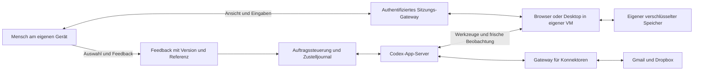

# Ein gemeinsamer Cloud-Arbeitsraum für Mensch und KI

Entwurf vom 21. November 2026. Technische Entscheidungen sind Vorschläge; bestätigte lokale Funktionen stehen im [Experiment](../experimental/human-workspace/README.md). Der Codex-Ausgangspunkt ist `openai/codex` bei `1145028ae47e8119955323d38ce34122d418f951`.

## Was der Mensch erleben soll

Der Mensch sieht das Ergebnis und kann genau dort reagieren: auf einen Satz, einen Ausschnitt eines Bildes, einen Moment oder Zeitraum eines Videos, eine Tabellenzelle oder ein Element einer Anwendung. Ein Kommentar kann Text, eine Aufnahme oder eine Referenzdatei enthalten. Die KI weiß, auf welche Version und Stelle sich das Feedback bezieht, arbeitet weiter und zeigt eine nachvollziehbare Änderung.

Die zentrale Interaktion lautet: **zeigen → erklären → verstehen lassen → Änderung ansehen → weiterarbeiten**. Der Mensch muss nicht für jede Rückmeldung einen neuen Chat mit einer erneuten Beschreibung des Kontexts beginnen. Häufiges Feedback soll wenig Aufwand verursachen; es soll nicht ständig eine Bestätigung verlangt werden.

Praktische Verbesserungen für diesen Ablauf:

- Eine gemeinsame Aktion **Hier Feedback geben** auf jeder Arbeitsfläche. Auswahl und Kontext werden automatisch mitgegeben.
- Beim Video ein Einzelzeitpunkt oder Zeitraum, bei Bildern eine Region, bei Texten ein Zitat samt Position. Sprache und Bildschirmaufnahme sind zusätzliche Eingaben.
- Ein dauerhaft erreichbares **Übernehmen** für die Eingaben des Menschen. Die KI pausiert und verwendet nach der Übergabe einen neuen Screenshot oder Zustand.
- Rückmeldungen können einer einzelnen Änderung, dem Projekt oder einer ausdrücklich gewählten dauerhaften Präferenz gelten. Eine Korrektur wird nicht automatisch zu einer globalen Regel.
- Die KI kann auf ein Feedback mit einer gezielten Rückfrage oder einer Vorschau der beabsichtigten Änderung reagieren. Das nächste Ergebnis erscheint an derselben Stelle.
- Undo, Versionsvergleich und offene Rückmeldungen bleiben erreichbar. Der Nutzer sieht, welche Rückmeldung bereits verarbeitet wurde und was noch offen ist.

Der konkrete Riley-Brown-Verweis ist ohne einen Produktlink nicht eindeutig identifiziert. Dieser Entwurf übernimmt die beschriebene Interaktion; er behauptet keine verifizierten Grenzen eines bestimmten Produkts.

## Was wir von OpenAI verwenden können

Der öffentliche [Codex-Quellcode](https://github.com/openai/codex) stellt den CLI-Agenten bereit. Der Fork ist der Ausgangspunkt für eigene Erweiterungen. Er überträgt keine OpenAI-Modellgewichte und stellt keinen eigenen Betrieb von OpenAIs Produktinfrastruktur bereit.

Der [Codex-App-Server](https://learn.chatgpt.com/docs/app-server) bietet Threads, Turns, Ereignisse und Freigabeanforderungen für eigene Clients. `turn/steer` kann ein aktives Gespräch mit einer passenden `expectedTurnId` weitersteuern. Ein Frontend kann damit während der Arbeit reagieren. Die Schnittstelle ist versionsabhängig; der hier installierte CLI-Stand und der geklonte Hauptzweig sind nicht dieselbe Version. Protokollfähigkeiten müssen zur tatsächlich eingesetzten Binärdatei geprüft werden.

[Codex Cloud](https://learn.chatgpt.com/docs/environments/cloud-environments) führt Aufgaben in eigenen Arbeitsumgebungen aus und kann vorbereitete Pakete und Werkzeuge nutzen. Das ist ein möglicher Ausführungsort für unterstützte Aufgaben. Die Dokumentation belegt hier jedoch keinen frei verwendbaren Hostingdienst für ein eigenes dauerhaftes Desktop-SaaS mit eingebettetem Bildschirmstream. Das wäre vor einer Produktabhängigkeit gesondert zu verifizieren. Lokale Dateien, Prozesse und Browser-Anmeldungen werden [nicht automatisch in eine Cloud-Aufgabe übernommen](https://learn.chatgpt.com/docs/environments/modes).

Für ein eigenständiges Produkt lautet die Ausgangsentscheidung deshalb: **Codex-App-Server als Agentenbaustein, eigener oder angemieteter Desktop als Arbeitsmaschine.** Ein bestimmter Modellanbieter bleibt austauschbar, soweit der Agent und dessen Werkzeuge den Anbieter unterstützen. Modellzugang und Nutzungsrechte sind eine eigene Abhängigkeit.

## Aufbau



Das Gateway authentifiziert den Nutzer und leitet ihn ausschließlich an seine Sitzung. Die Steuerung verwaltet Arbeit, Rückmeldungen, Budgets und Ergebnisse dauerhaft. Ein Verbindungsabbruch schließt nicht versehentlich die ganze Arbeit; ein explizites Beenden stoppt sie und räumt Ressourcen auf.

Pro Nutzer beziehungsweise Sicherheitsbereich läuft mindestens eine eigene VM. Browserprofile, Dateisysteme, Netzberechtigungen, Konnektor-Zugänge und Agentenverlauf werden nicht zwischen Kunden geteilt. Innerhalb einer VM können zusätzliche getrennte Projektarbeitsräume sinnvoll sein. Ein bloßer Verzeichnisname oder Browserparameter ist keine Mandantengrenze.

Der Agent kontrolliert den tatsächlichen Browser oder Desktop in dieser VM. Der Mensch bekommt dieselbe Sitzung übertragen. Zwei unabhängig laufende Browser mit nachgebildeten Klicks würden dagegen bei Anmeldung, Navigation und Popup-Zustand auseinanderlaufen.

## Wie die Spiegelung funktionieren soll

Für einen Browser nimmt der Agent strukturierte Browserwerkzeuge, wo sie verfügbar und zuverlässig sind. Für andere Anwendungen nutzt er die jeweilige Betriebssystem-Schnittstelle und Screenshots. Der Stream für den Menschen ist ein eigener Kanal; die KI kann relevante Screenshots direkt innerhalb der VM erhalten, statt das komprimierte Bild vom Nutzergerät wieder auszulesen.

Die [offizielle OpenAI-Computer-Use-Dokumentation](https://developers.openai.com/api/docs/guides/tools-computer-use#connect-a-hosted-environment) nennt bereits gehostete Browser- und Desktop-Integrationen. Für einen schnellen Pilot ist ein temporärer Desktopdienst praktikabel. [E2B Desktop](https://docs.e2b.dev/agents/openai-computer-use) dokumentiert einen isolierten Ubuntu-Desktop, Computeraktionen und einen authentifizierbaren noVNC-Stream. Der vorbereitete Adapter verwendet diesen Weg, startet ihn aber standardmäßig nicht.

Für einen stärker selbst verwalteten Aufbau ist eine Linux-VM auf AWS mit [Amazon DCV](https://docs.aws.amazon.com/dcv/latest/adminguide/what-is-dcv.html) eine Option: Anwendungen laufen auf dem Server; deren Ausgabe und Eingaben werden über einen verschlüsselten Remote-Display-Kanal übertragen. [Apache Guacamole](https://guacamole.apache.org/doc/gug/guacamole-architecture.html) ist ein anderer dokumentierter Browser-Gateway-Ansatz für Remote-Desktop-Protokolle. Die Auswahl hängt von Latenz, Videoqualität, Betrieb und Lizenzbedingungen ab.

Zuerst installieren wir in einer Testmaschine nur Browser, Dateiwerkzeuge und eine benötigte Desktopanwendung. Spätere Apps bekommen reproduzierbare Basis-Images und einen getrennten Nutzer-Datenträger. Ein normaler Linux-Desktop führt keine macOS-Anwendungen aus. Für macOS-Arbeit braucht es einen passenden Mac-Ausführungsort; vorhandene lokale Sitzungen können über einen gesondert autorisierten lokalen Adapter eingebunden werden. Native Plattformgleichheit wird separat geprüft.

Ein gemeinsamer Eingabe-Besitz verhindert gleichzeitige Maus- und Tastatureingaben. **Übernehmen** sperrt neue Agentenaktionen sofort, verwirft wartende Eingaben und wartet den bereits gestarteten Schritt ab. Erst dann erhält der Mensch die Eingaben. Beim Zurückgeben werden laufende Aktionen und der sichtbare Zustand erneut gelesen. Ein Klick erhält Sitzungs-ID, Kontrollgeneration und eine frische Beobachtung; veraltete Koordinaten werden abgewiesen. Reines `viewOnly` im Viewer ist dafür keine vollständige Berechtigungsgrenze.

## Datenreferenz für Feedback

```json
{
  "feedbackId": "unique-feedback-id",
  "workspaceId": "server-derived-workspace",
  "artifactId": "clip-17",
  "revision": "sha256-of-source",
  "anchor": {
    "kind": "video",
    "timeStartMs": 12400,
    "timeEndMs": 15100,
    "region": { "x": 0.25, "y": 0.30, "width": 0.20, "height": 0.10 }
  },
  "comment": "An dieser Stelle bitte den Übergang ruhiger machen.",
  "attachments": ["reference-video-5"],
  "scope": "this-change"
}
```

Das ist der geplante vollständige Vertrag. Der lokale Prototyp implementiert Textbereiche, Einzelzeitpunkte und Bildpunkte; Zeiträume, Rechteckregionen, Sprachaufnahmen und App-Adapter folgen später.

Die Kundenzuordnung kommt aus der authentifizierten Serversitzung. Der Server prüft Artefaktbesitz, aktuelle Revision, Anker und Anhänge. Pro Feedback gibt es eine eindeutige Zustell-ID. Nach einem Timeout wird zuerst die Quittung abgefragt, bevor ein neuer Modellauftrag entsteht. Ein Ergebnis referenziert wiederum Feedback-ID, Ausgangsversion, erzeugte Version und Status. Alte Zitate werden nicht stillschweigend auf neue Texte übertragen.

Bei Videos reicht eine Sekundenzahl nicht als visuelle Eingabe. Ein Adapter muss die passenden Frames und, falls nötig, Audio oder Transkript tatsächlich bereitstellen. Ein einzelnes Frame kann keine Bewegung oder Tonspur belegen. Koordinaten beziehen sich auf die Inhaltsfläche und berücksichtigen deren Größe und eventuelle Ränder. Dateinamen und Metadaten gelten nicht als Bildbeweis.

## Trennung und Verschlüsselung

Für den ersten Aufbau ist keine neue Hardware nötig. Klassische VMs und bereits verfügbare Hardwarefunktionen sind der Ausgangspunkt. Eine eigene physische Festplatte pro Kunde ist keine Voraussetzung für getrennte Daten. Der Entwurf kombiniert isolierte Ausführung, konsequente Autorisierung und kryptografisch getrennte Schlüssel.

| Ebene | Vorschlag | Was dadurch noch nicht garantiert ist |
| --- | --- | --- |
| Datenträger und Backups | Eigene Volumes/Objekte und Schlüssel pro Sicherheitsbereich, verschlüsselte Snapshots | Eine laufende Anwendung kann autorisierte Daten lesen |
| Netzwerk | TLS für APIs und sichere Remote-Display-Verbindungen | Der berechtigte Endpunkt muss die Daten verarbeiten |
| Ausführung | Eigene VM, minimale Rechte, getrennte Browserprofile, eingeschränkter Ausgangsverkehr | Kein absoluter Schutz gegen jede Host- oder VM-Schwachstelle |
| Anbieterzugriff auf RAM | Bei entsprechendem Schutzbedarf eine geeignete Confidential VM mit Attestation | Anwendung, Freigabeprozess und nachgelagerte Modellaufrufe bleiben Teil der Vertrauenskette |
| Schlüssel | Daten-Schlüssel werden über einen getrennten Schlüssel-Dienst oder einen Nutzer-Schlüssel freigegeben | Schlüsselwiederherstellung und Arbeiten ohne anwesenden Nutzer brauchen eine klare Regel |

[AWS EBS](https://docs.aws.amazon.com/ebs/latest/userguide/ebs-encryption.html) dokumentiert verschlüsselte Volumes und Snapshots mit KMS. Für Schutz während der Verarbeitung ist zusätzlich etwa [AMD SEV-SNP auf passenden EC2-Instanzen](https://docs.aws.amazon.com/AWSEC2/latest/UserGuide/sev-snp.html) zu prüfen. Unterstützte Regionen, Gastbetriebssysteme und Instanztypen sind Einschränkungen; wir behandeln sie nicht als überall verfügbare Einstellung.

Der Gedanke mit zwei passenden Codes lässt sich als Kryptografie präzisieren: Ein öffentlicher Schlüssel kann Daten für seinen Besitzer verschlüsseln; der zugehörige private Schlüssel ermöglicht die Entschlüsselung. Für große Dateien verwendet man normalerweise zufällige symmetrische Daten-Schlüssel und schützt diese wiederum mit einem anderen Schlüssel. Eine Signatur kann die Berechtigung nachweisen. Das braucht weder Bitcoin noch eine Blockchain.

Wenn ausschließlich der Nutzer den Entschlüsselungsschlüssel besitzt, muss er die laufende VM zeitweise zum Entschlüsseln berechtigen. Unbeaufsichtigte Arbeit benötigt entsprechend eine begrenzte, widerrufbare Delegation. Wenn ein externer KI-Anbieter Klartext oder Screenshots erhält, sieht dessen Verarbeitung diese Eingabe trotz verschlüsselter Festplatte. Ein Produkt darf daher nicht pauschal behaupten, dass außer dem Nutzer niemand Daten verarbeiten könne.

Normale Speicher- und Transportverschlüsselung ist von Rechnen auf ständig verschlüsselten Daten zu unterscheiden. Für einen kompletten interaktiven Desktop planen wir keine vollständig homomorphe Ausführung. [Microsoft SEAL](https://github.com/microsoft/SEAL) beschreibt die Beschränkung auf bestimmte arithmetische Operationen und die schwierige effiziente Umsetzung komplexerer Programme. Daraus folgt als Entwurfsentscheidung: eine geschützte Ausführungsumgebung ist für diesen Pilot der praktikablere Ansatz. Ein konkreter Performanceaufschlag muss gemessen werden.

[Firecracker](https://firecracker-microvm.github.io/) bietet vorhandene microVM-Technik mit KVM-Isolation. Das ist ein möglicher späterer Baustein für viele kleine Agenten-Worker. Für einen Desktop mit breiter Geräte- oder GPU-Unterstützung beginnen wir mit einer normalen geeigneten VM und prüfen die Kompatibilität, bevor wir auf microVMs optimieren. Container allein sind hier nicht als einzige Kundengrenze vorgesehen.

## Hardwareideen, falls ein späterer Markt sie rechtfertigt

1. **Kleine private Arbeitsmaschine beim Nutzer.** Ein Mini-PC mit TPM, verschlüsselter SSD und einem ausschließlich ausgehenden Tunnel. Die Cloud vermittelt Sitzungen; lokale Arbeit und ausgewählte Daten können auf diesem Gerät bleiben. Das ist ein Standardhardware-Prototyp, kein neuer Chip.
2. **Dedizierter Rechner oder Serverknoten pro Kunde.** Physisch getrennte Rechner und Laufwerke für Kunden, deren Anforderung das rechtfertigt. Höherer Aufwand für Kosten, Updates und Wiederherstellung; Netzwerk und Berechtigungen brauchen trotzdem eigene Grenzen.
3. **Confidential-Compute-Server aus vorhandenen Komponenten.** Geeignete CPUs, gemessener Start, Attestation und ein Schlüssel-Dienst, der Schlüssel nur an eine geprüfte Umgebung freigibt. Das ist zunächst Systemintegration.
4. **Persönlicher Sicherheitsschlüssel.** Passkey oder Hardware-Token bestätigt eine zeitlich begrenzte Sitzung. Der Schlüssel ist ein Freigabegerät; er führt nicht den ganzen Desktop aus und ersetzt keinen Schutz der laufenden Software.

Eigene Platinen oder ein eigener Verschlüsselungschip werden erst sinnvoll, wenn ein messbarer Nachteil der Standardkomponenten feststeht. Vorher wären Bedarf, Bedrohungsmodell, Leistungsaufnahme, Stückzahl, Betrieb und Wiederherstellung zu testen.

## Gmail, Dropbox und weitere Konnektoren

Konnektoren sollen strukturierte Aufgaben zuverlässig erledigen; der Browser deckt die übrigen Oberflächen ab. Ein gemeinsames Gateway führt OAuth, Berechtigungsprüfung, Kontozuordnung, Quoten und Protokollierung zusammen. Das Protokoll kann über [MCP](https://developers.openai.com/api/docs/guides/tools-connectors-mcp) angeboten werden; MCP ersetzt nicht die jeweilige Anmeldung oder die Zugriffskontrolle des Dienstes.

[Gmail](https://developers.google.com/workspace/gmail/api/auth/scopes) unterscheidet Berechtigungsbereiche und nennt Verifikationsanforderungen für bestimmte Datenzugriffe. Wir beginnen mit dem kleinsten passenden Zugriff für den konkreten Ablauf; eine Leseanbindung autorisiert keinen Versand. Für Dropbox sind [OAuth und begrenzte Scopes](https://developers.dropbox.com/oauth-guide) dokumentiert. Wo ein ausgewählter Ordner oder eine Dateiauswahl genügt, wird nicht pauschal der gesamte Speicher angefordert.

Für den Pilot werden zuerst Testdaten und ein Testkonto verwendet. Tokens bleiben außerhalb des Agenten-Arbeitsverzeichnisses und außerhalb des Frontends. Der Gateway prüft jede Aktion. Schreiben, Senden und Löschen bekommen eine eigene aufgabenbezogene Freigabe. Fremde Dokumente und Webseiten sind Daten und keine Berechtigungsquelle. Die bestehende Browser-Anmeldung auf dem Mac wird nicht unbemerkt in eine Cloud-VM kopiert.

## Wie wir die Qualität wirklich vergleichen

Die Qualität hängt vom Modell, den Werkzeugen, der Beobachtung, dem Betriebssystem, dem Anmeldestatus und den Rückmeldeschleifen ab. Ein gleicher Bildschirmstream beweist noch keine gleich gute Computerbedienung. Wir halten Modell, Aufgaben, Ausgangsdaten und Erfolgskriterien möglichst konstant und vergleichen dann lokal gegen Cloud.

Der erste Vergleich umfasst 20 festgelegte Aufgaben mit Testdaten: Browsernavigation, Dateiupload, Formularänderung, Textbearbeitung, Tabellenarbeit, Videozeitpunkt und Eingriffsübergabe. Die wichtigen Abläufe werden mehrfach wiederholt. Native macOS-Aufgaben bilden eine eigene Gruppe und werden nicht mit Linux-Erfolgen als abgedeckt gewertet.

| Messgröße | Geplanter Nachweis |
| --- | --- |
| Aufgabenerfolg | Prüfung des tatsächlichen Endzustands je Aufgabe |
| Referenztreue | Richtige Version, Textstelle, Bildposition oder Videosekunde |
| Eingriff | Mensch kann übernehmen; nach Übergabe laufen keine alten Agenteneingaben weiter |
| Verbindungsabbruch | Sitzung wiederfinden, keine doppelte Zustellung, definierter Ressourcenabbau |
| Darstellung | Kleine Schrift, Skalierung, Videobewegung und Kompression visuell prüfen |
| Zeit | Antwortzeit, Klick bis sichtbares Ergebnis sowie Median und langsames Ende der Messungen |
| Kosten | Modellnutzung, VM-Zeit, Speicher und Datenübertragung pro Aufgabe |
| Trennung | Nutzer A kann weder Dateien noch Verlauf, Stream oder Tokens von Nutzer B erreichen |

Zielwerte werden nach einer lokalen Ausgangsmessung festgelegt. Es gibt aktuell keinen gemessenen Beleg für Qualitätsgleichheit und keinen belastbaren Preis pro Nutzer.

## Reihenfolge der Umsetzung

1. Lokale Feedback-Referenzen und gemeinsame Ansicht ausprobieren. Dieser Schritt ist im Experiment umgesetzt.
2. Einen leeren Cloud-Desktop für wenige Minuten spiegeln und manuell bedienen. Der optionale Adapter ist vorbereitet; Anbieterzugang und ein freigegebenes Budget fehlen für einen echten Test.
3. Einen Agenten an genau diese Sitzung anschließen, Eingabe-Besitz und Abbruch testen und den Aufgabensatz messen. Den Modellzugang separat freigeben.
4. Persistente Nutzer-Volumes, Anmeldung, Mandantengrenzen, Wiederherstellung und ein dauerhaftes Zustelljournal implementieren.
5. Einen Konnektor mit Testdaten anbinden, dann echte Konten nur für ausdrücklich gewählte Aufgaben freischalten.
6. Erst anhand der Messungen entscheiden, ob verwaltete Desktopdienste, eigene AWS-VMs oder eigene physische Rechner die geeignete Betriebsform sind.

Der erste externe Test umfasst eine einzelne temporäre Desktop-Sitzung ohne private Dateien oder Konten. Vor seinem Start müssen Anbieter, Konto, Laufzeit und ein akzeptierter Kostenrahmen feststehen. Bis dahin werden weder Cloud-Ressourcen angelegt noch Konnektoren autorisiert.
